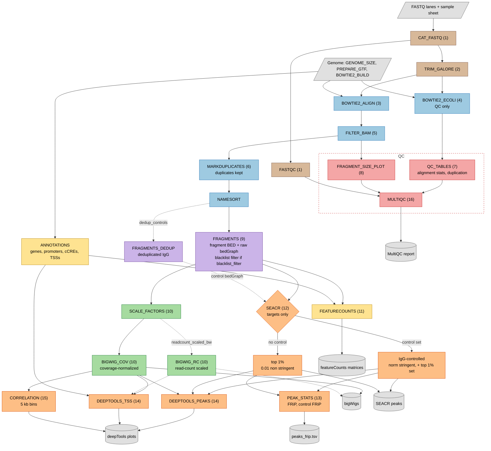

# CnT-processing

A small, readable Nextflow (DSL2) pipeline for paired-end CUT&Tag data.
It takes FASTQ files and produces:

1. Coverage-normalized bigWigs
2. Optional read-count scaled bigWigs, for comparison with (1)
3. featureCounts matrices over protein-coding genes, promoters and ENCODE cCREs
4. SEACR peaks (IgG-controlled when a control is given), FRiP, peak stats and deepTools plots at peaks and TSSs
5. QC tables: alignment stats (with % chrM), fragment sizes, duplication (with optical duplicates), E. coli carry-over, sample correlation
6. A MultiQC report

The tool choices and settings follow the Henikoff lab
[CUT&Tag tutorial](https://yezhengstat.github.io/CUTTag_tutorial/) and
[nf-core/cutandrun 1.1](https://nf-co.re/cutandrun/1.1/). This pipeline is not
a fork of nf-core/cutandrun. It does no spike-in normalization.

- [Workflow](#workflow)
- [Quick start](#quick-start)
- [Sample sheet](#sample-sheet)
- [Key parameters](#key-parameters)
- [Main outputs](#main-outputs)
- [More documentation](#more-documentation)

## Workflow



Each color is one stage. The Details column links to the full description.

| Color | Stage | Steps | Details |
|---|---|---|---|
| ⬜ grey | Inputs and outputs | - | [Inputs](docs/inputs.md), [Output files](docs/outputs.md) |
| 🟫 brown | Read preparation | 1-2 | [Read preparation](docs/steps.md#read-preparation) |
| 🟦 blue | Alignment and filtering | 3-6 | [Alignment and filtering](docs/steps.md#alignment-and-filtering) |
| 🟪 purple | Fragments | 9 | [Fragments](docs/steps.md#fragments) |
| 🟩 green | Coverage and bigWigs | 10 | [Coverage and bigWigs](docs/steps.md#coverage-and-bigwigs) |
| 🟨 yellow | Feature counts | 11 | [Feature counts](docs/steps.md#feature-counts) |
| 🟧 orange | Peaks and signal plots | 12-15 | [Peaks and signal plots](docs/steps.md#peaks-and-signal-plots) |
| 🟥 red | QC reports | 7, 8, 16 | [QC reports](docs/steps.md#qc-reports) |

Solid arrows always run. Dotted arrows run only when the named parameter is
true. Numbers in brackets are step numbers. The [step table](docs/steps.md#all-steps)
lists all 16 steps. Some minor inputs are not drawn; see
[what the diagram leaves out](docs/steps.md#what-the-diagram-leaves-out).

## Quick start

You need [Nextflow](https://www.nextflow.io/) 24.04 or later, and Docker,
Singularity / Apptainer, or (at Fred Hutch) the Lmod modules.

```bash
nextflow run jacob-greene/CnT-processing -profile <profile> -params-file params.json
```

Use the `docker`, `singularity` or (Fred Hutch) `slurm` profile. To try the
pipeline on the small test data set:

```bash
nextflow run jacob-greene/CnT-processing -profile test,docker --outdir results
```

More: [all profiles, the Fred Hutch cluster, the BASH Workbench, resume and
clean-up](docs/running.md), and [the tests](docs/testing.md).

## Sample sheet

A CSV file with one row per FASTQ pair. Rows with the same `sample` are lanes
and are joined.

```
sample,fastq_1,fastq_2,control,is_control,pool
H3K27me3_rep1,/path/to/H3K27me3_rep1_R1.fastq.gz,/path/to/H3K27me3_rep1_R2.fastq.gz,IgG_rep1,false,pool1
IgG_rep1,/path/to/IgG_rep1_R1.fastq.gz,/path/to/IgG_rep1_R2.fastq.gz,,true,pool1
```

`sample`, `fastq_1` and `fastq_2` are required. `control` names the IgG sample
of a target. The pipeline checks the sheet before any job starts. More:
[sample sheet columns and checks](docs/inputs.md#sample-sheet),
[IgG controls](docs/inputs.md#igg-controls) and
[supported genomes](docs/inputs.md#supported-genomes) (`hg38`, `hg19`, `mm10`,
`dm6`).

## Key parameters

Parameters go in a JSON file (`params.json`) or on the command line as
`--name value`. `examples/params.json` is a complete example.

| Parameter | Default | Meaning |
|---|---|---|
| `samplesheet` | required | Sample sheet CSV |
| `genome` | required | `hg38`, `hg19`, `mm10` or `dm6` |
| `outdir` | `results` | Output folder |
| `readcount_scaled_bw` | `false` | Also write [read-count scaled bigWigs](docs/steps.md#coverage-and-bigwigs) |
| `dedup_controls` | `false` | SEACR uses deduplicated control fragments |
| `blacklist_filter` | `false` | Remove [blacklisted fragments](docs/steps.md#blacklist-filtering-optional) |

All parameters: [Parameters](docs/running.md#parameters).

## Main outputs

| Output | What it is |
|---|---|
| `bigwig/coverage_norm/` | Coverage-normalized bigWigs ([how](docs/steps.md#coverage-and-bigwigs)) |
| `featurecounts/` | Fragment counts over genes, promoters and cCREs |
| `seacr/` | SEACR peaks of each target |
| `peaks_frip.tsv` | Peak count, widths, FRiP and control FRiP per target |
| `alignment_stats.tsv` | One QC row per sample |
| `multiqc/multiqc_report.html` | The MultiQC report |

All outputs: [Output files](docs/outputs.md).

## More documentation

| Page | Contents |
|---|---|
| [Workflow steps](docs/steps.md) | Every step, its tool and settings, normalization, blacklist filter, featureCounts and correlation notes |
| [Inputs](docs/inputs.md) | Input data, sample sheet, IgG controls, supported genomes |
| [Running](docs/running.md) | All parameters, profiles, Fred Hutch cluster, BASH Workbench, resume and clean-up |
| [Output files](docs/outputs.md) | The output folder and the `alignment_stats.tsv` columns |
| [Testing](docs/testing.md) | Test data and the output checks |

## Authors

Jacob Greene

## License

MIT
